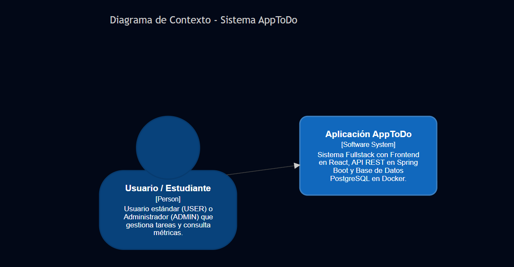
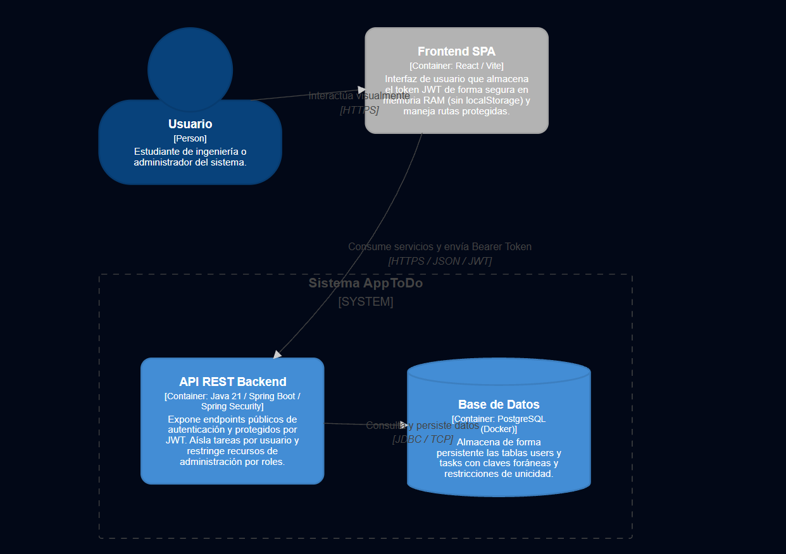
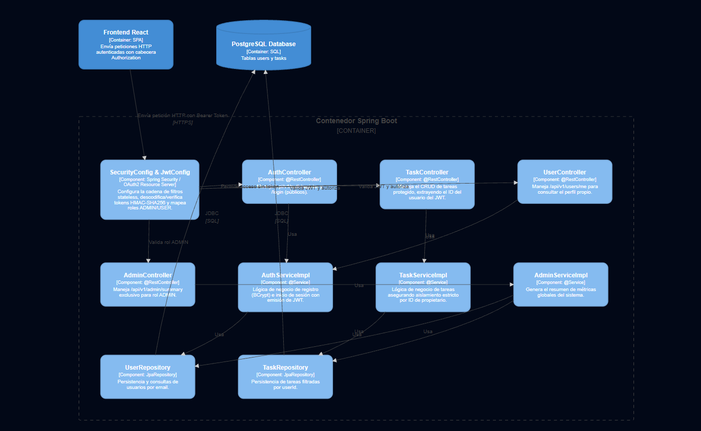
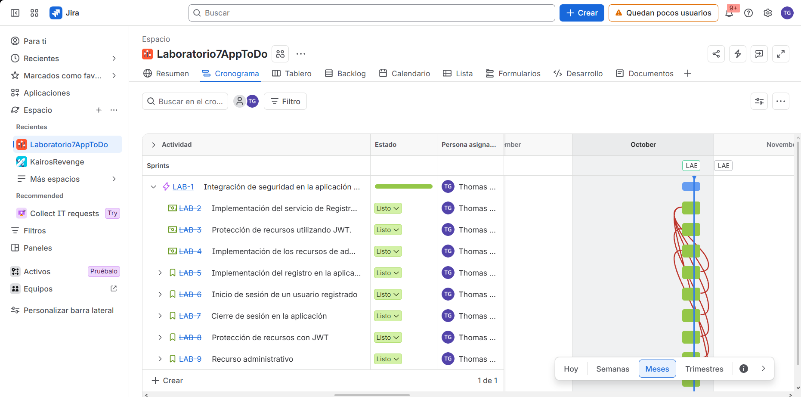
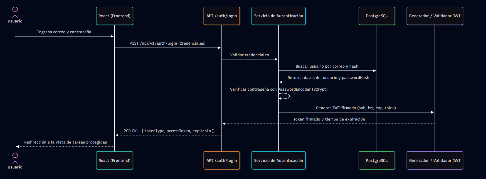
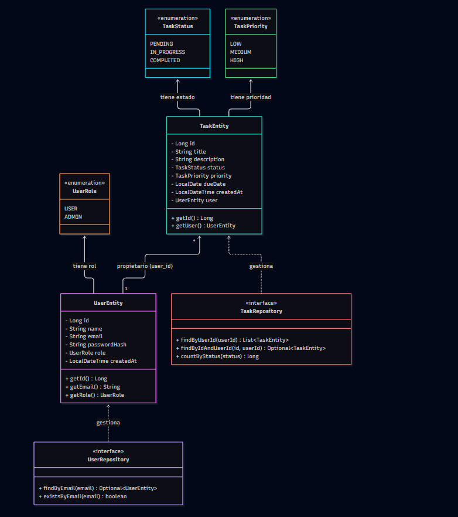
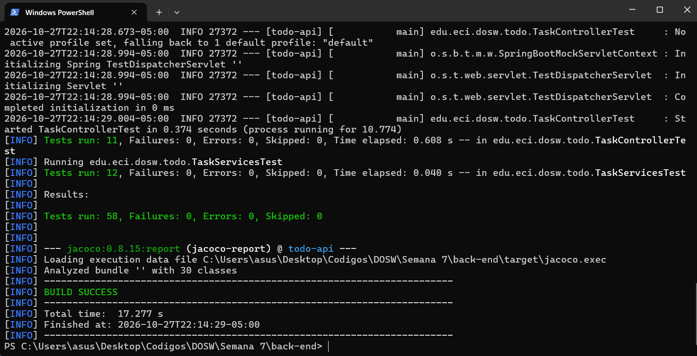
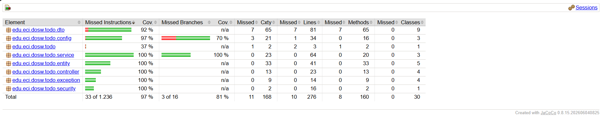

# Laboratorio7_Thomas_AppToDo_Backend
Este repositorio hace parte del laboratorio 7 de la materia de DOSW, sección BackEnd de la aplicación propuesta AppToDo

| Name                            | GitHub Username                   |
|---------------------------------|-----------------------------------|
| Daniel Santiago Morales Perdomo | `Fukuyaku88`                      |
| Edgar Daniel Ruiz Patiño        | `DaniRuiz11`                      |
| Miguel Ángel Acero Laverde      | `Miguelim101`                     |
| Thomas Sebastian García Gomez   | `thomassebastiangarciagomez-ctrl` |

## Parte 1: Desarollo del laboratorio

Primero, para esta parte se realizara la actualizacion de diferentes sistemas para aceptar las nuevas implementaciones dentro del codigo, lo primero, es actualizar los diagramas C4, donde los diagramas asociados serán los siguientes


1. Diagrama de contexto:



2. Diagrama de contenedores:



3. Diagrama de componentes:



Ahora, despues de realizar esta actualizacion, se tienen que agregar las dependencias necesarias dentro del pom.xml para poder realizar la integracion adecuada de este sistema. Las dependencias que se agregaran son las siguientes.

```xml
<dependency>
    <groupId>org.springframework.boot</groupId>
    <artifactId>spring-boot-starter-security</artifactId>
</dependency>

<dependency>
    <groupId>org.springframework.boot</groupId>
    <artifactId>spring-boot-starter-security-oauth2-resource-server</artifactId>
</dependency>

<dependency>
    <groupId>org.springframework.boot</groupId>
    <artifactId>spring-boot-starter-security-test</artifactId>
    <scope>test</scope>
</dependency>
<dependency>
    <groupId>org.springframework.boot</groupId>
    <artifactId>spring-boot-starter-security-oauth2-resource-server-test</artifactId>
    <scope>test</scope>
</dependency>
```

Con esto, ya tendremos las dependencias adecuadas para poder realizar la integracion de todo el sistema de seguridad en nuestra aplicacion AppToDo.

## Parte 2: Requerimientos e historias de usuario:

Los requerimientos asociados a esta nueva implementacion, apoyandonos de los recursos proporcionados en el laboratorio, se pueden hablar de los siguientes 10 requerimientos.

| Campo | Descripción |
|------|-------------|
| **ID** | RF-01 |
| **Nombre del requerimiento** | Registrar usuario |
| **Descripción** | *Desde la aplicacion de AppToDo, se permite que un nuevo usuario pueda crear una cuenta dentro del sistema, aqui se solicitara un nombre, correo y una contraseña para que el nuevo usuario se registre.* |
| **Precondiciones** | *Se debe tener previamente lo realizado el laboratorio 6, junto con el scafolding creado y codigo funcional. Se tiene que tener implementado una interfaz grafica para poder acceder a esta funcion* |
| **Actor** | *Nuevos usuarios* |
| **Flujo principal** | El flujo principal de la aplicacion es el siguiente<br>1. el usuario ingresa a la aplicacion AppToDo<br>2. Se dirigue hacia un boton en la barra inferior que dice "registrar"<br>3. El usuario entra en el panel de registro donde se le solicitara un nombre, un correo y una contraseña.<br>4. Cuando el usuario termine de registrar stta informacion, este debe darle al boton de registrar, el cual lo reenviara a la pantalla de autenticacion de usuario para ingresar a la aplicacion. |
| **Diagrama de caso de uso** |  |
| **Poscondiciones** | 1. El usuario debe poder crear su cuenta de manera correcta.<br>2. La nueva cuenta debe guardarse en la base de datos con la contraseña codificada. |

| Campo | Descripción |
|------|-------------|
| **ID** | RF-02 |
| **Nombre del requerimiento** | Autenticar usuario |
| **Descripción** | *El usuario que ya esta registrado en la base de datos puede ingresar en la aplicacion con su correo y su contraseña correspondiente* |
| **Precondiciones** | *Se debe tener previamente lo realizado el laboratorio 6, junto con el scafolding creado y codigo funcional* |
| **Actor** | *Usuarios* |
| **Flujo principal** | El flujo principal de la aplicacion es el siguiente<br>1. El usuario ingresa a la aplicacion<br>2. Se le presenta el formulario de autenticacion, donde se le solicita el correo y la contraseña<br>3. Despues de ingresar los datos este se dirige al boton de iniciar sesion, donde lo llevara a la pestaña principal. |
| **Diagrama de caso de uso** |  |
| **Poscondiciones** | 1. El usuario ingresa en la aplicacion de manera correcta si ingresa los datos adecuados<br>2. Se rechaza el acceso no autorizado, o sea, se rechaza una peticion realizada de manera incorrecta.<br>3. Cuando ingresa el usuario este es enviado al menu principal. |

| Campo | Descripción |
|------|-------------|
| **ID** | RF-03 |
| **Nombre del requerimiento** | Mantener sesión en React |
| **Descripción** | *Cuando un usuario ingresa a su cuenta, se debe mantener la sesion de manera adecuada, debe poder realizar acciones sobre su propia cuenta.* |
| **Precondiciones** | *Se debe tener creado el sistema de registro y de autenticar usuario dentro del sistema* |
| **Actor** | *Usuarios* |
| **Flujo principal** | El flujo principal de la aplicacion es el siguiente<br>1. El usuario entra en la aplicacion con sus credenciales correctas<br>2. El usuario puede realizar acciones sobre su cuenta, las cuales son agregar y modifcar tareas.<br>3. El usuario debe mantener sesion en todo momento. |
| **Diagrama de caso de uso** |  |
| **Poscondiciones** | 1. El usuario en todo momento debe mantener su sesion conectada. |

| Campo | Descripción |
|------|-------------|
| **ID** | RF-04 |
| **Nombre del requerimiento** | Consultar perfil |
| **Descripción** | *El usuario tiene la opcion de poder consultar las opciones del perfil, de tal forma que se pueda ver la informacion relevante del mismo* |
| **Precondiciones** | *Tener un sistema de registro y de autenticacion de usuarios implementado en el sistema* |
| **Actor** | *Usuarios* |
| **Flujo principal** | El flujo principal de la aplicacion es el siguiente<br>1. El usuario ingresa a la aplicacion<br>2. Este tiene la opcion de acceder a la informacion de su cuenta en la esquina superior derecha de la aplicacion. |
| **Diagrama de caso de uso** |  |
| **Poscondiciones** | 1. El usuario puede consultar su informacion<br>2. El usuario no puede consultar la informacion de otros usuarios. |

| Campo | Descripción |
|------|-------------|
| **ID** | RF-05 |
| **Nombre del requerimiento** | Proteger el CRUD |
| **Descripción** | *A partir de la implementación de Spring Security, todos los endpoints asociados a la gestión de tareas (CRUD) exigen obligatoriamente la presentación de un token JWT válido y firmado en la cabecera HTTP (Authorization: Bearer <token>) para permitir cualquier operación.* |
| **Precondiciones** | *Haber implementado con éxito el sistema de autenticación de usuarios, la emisión de JWT y la cadena de filtros de Spring Security en el backend.* |
| **Actor** | *Usuarios autenticados* |
| **Flujo principal** | 1. El usuario intenta realizar una operación sobre las tareas (consultar, crear, editar o eliminar).<br>2. El cliente React adjunta el token JWT actual en la cabecera de la petición.<br>3. El filtro de seguridad de Spring intercepta la solicitud, valida la firma criptográfica, la vigencia temporal y extrae las credenciales.<br>4. Si el token es válido, la solicitud avanza al controlador; si es inválido, ausente o expirado, se rechaza de inmediato con código HTTP 401. |
| **Diagrama de caso de uso** |  |
| **Poscondiciones** | 1. Se previene cualquier acceso anónimo o no autenticado a los recursos de tareas.<br>2. Se responde con `401 Unauthorized` ante solicitudes sin token, alteradas o caducadas. |

| Campo | Descripción |
|------|-------------|
| **ID** | RF-06 |
| **Nombre del requerimiento** | Aislar tareas por usuario |
| **Descripción** | *El sistema garantiza que los datos y operaciones de las tareas estén estrictamente aislados por propietario. Ningún usuario podrá listar, consultar, crear, modificar o eliminar tareas pertenecientes a otra cuenta.* |
| **Precondiciones** | *Tener relacionada la entidad de tareas con el usuario propietario mediante clave foránea en la base de datos y la identidad extraída del contexto de seguridad de Spring.* |
| **Actor** | *Usuarios autenticados* |
| **Flujo principal** | 1. El usuario realiza una petición sobre el CRUD de tareas.<br>2. El backend extrae la identidad del usuario autenticado directamente desde el contexto de seguridad (JWT), ignorando cualquier parámetro de ID de usuario enviado por el cliente.<br>3. Los repositorios y servicios filtran las consultas SQL limitándolas al ID del propietario actual.<br>4. Si se intenta acceder a una tarea que no existe o que pertenece a otro usuario, el sistema responde consistentemente con `404 Not Found` para no filtrar la existencia del recurso. |
| **Diagrama de caso de uso** |  |
| **Poscondiciones** | 1. El usuario solo visualiza e interactúa con sus propias tareas.<br>2. Se evita la vulnerabilidad de acceso cruzado (IDOR), respondiendo con `404 Not Found` en intentos de manipulación sobre registros ajenos. |

| Campo | Descripción |
|------|-------------|
| **ID** | RF-07 |
| **Nombre del requerimiento** | Gestionar autorización por roles |
| **Descripción** | *El sistema restringe determinados endpoints administrativos exclusivos a usuarios que posean el rol `ADMIN`, denegando el acceso a cuentas estándar con rol `USER`.* |
| **Precondiciones** | *Tener configurados los roles `USER` y `ADMIN` en el modelo de usuarios y mapeados correctamente en las autoridades (Authorities) de Spring Security a partir de los claims del JWT.* |
| **Actor** | *Administradores / Usuarios con rol ADMIN* |
| **Flujo principal** | 1. Un usuario con rol `ADMIN` realiza una petición al recurso protegido (ej. `/api/v1/admin/summary`).<br>2. Spring Security valida el token y comprueba que la autoridad contenga el rol administrativo.<br>3. Se procesa la solicitud y se retorna la información agregada con código `200 OK`.<br>4. Si un usuario con rol `USER` intenta acceder, el servidor rechaza la petición con código `403 Forbidden`. |
| **Diagrama de caso de uso** |  |
| **Poscondiciones** | 1. Se asegura el aislamiento de funciones privilegiadas frente a usuarios comunes.<br>2. Se responde correctamente con `403 Forbidden` ante intentos de elevación de privilegios lógicos. |

| Campo | Descripción |
|------|-------------|
| **ID** | RF-08 |
| **Nombre del requerimiento** | Cerrar sesión en frontend |
| **Descripción** | *Permite al usuario finalizar su sesión activa desde la interfaz de usuario en React, limpiando el estado de autenticación y retornando a la pantalla de inicio de sesión.* |
| **Precondiciones** | *El usuario debe encontrarse con una sesión activa y autenticada en la aplicación.* |
| **Actor** | *Usuarios autenticados* |
| **Flujo principal** | 1. El usuario hace clic en el botón "Cerrar sesión" ubicado en la barra superior de la aplicación.<br>2. La aplicación React elimina el token JWT almacenado en memoria (estado o contexto global).<br>3. Se limpian los estados de tareas y perfil del usuario anterior.<br>4. La interfaz redirige automáticamente al formulario de inicio de sesión. |
| **Diagrama de caso de uso** |  |
| **Poscondiciones** | 1. El token y los datos del usuario se purgan de la interfaz.<br>2. Se previene la visualización residual de tareas privadas tras el cierre de sesión. |

| Campo | Descripción |
|------|-------------|
| **ID** | RF-09 |
| **Nombre del requerimiento** | Manejar errores de seguridad |
| **Descripción** | *El backend implementa un manejo centralizado de excepciones para categorizar y responder adecuadamente ante fallos de validación, autenticación, autorización o recursos no encontrados.* |
| **Precondiciones** | *Disponer de un controlador global de excepciones (`@ControllerAdvice`) configurado en Spring Boot.* |
| **Actor** | *Sistema / Cliente HTTP* |
| **Flujo principal** | 1. Ocurre una excepción de seguridad o negocio durante el procesamiento de una petición.<br>2. El manejador global intercepta el error y evalúa su naturaleza.<br>3. Se retorna un JSON estandarizado acompañado del código HTTP correcto (`400`, `401`, `403`, `404` o `409`) sin exponer trazas de pila sensibles al cliente. |
| **Diagrama de caso de uso** |  |
| **Poscondiciones** | 1. Se asegura una respuesta uniforme y predecible ante errores en la API.<br>2. Se protegen detalles internos de la implementación del servidor frente a atacantes externos. |

| Campo | Descripción |
|------|-------------|
| **ID** | RF-10 |
| **Nombre del requerimiento** | Validar seguridad mediante pruebas |
| **Descripción** | *La aplicación cuenta con un conjunto automatizado de pruebas unitarias y de integración orientadas a verificar los mecanismos de autenticación, la integridad de los tokens, el aislamiento de datos por usuario y el control de acceso por roles.* |
| **Precondiciones** | *Tener configurados los frameworks de pruebas (JUnit 5, Mockito, MockMvc / Spring Security Test para backend; Vitest / React Testing Library para frontend).* |
| **Actor** | *Desarrolladores / Sistema de Integración Local* |
| **Flujo principal** | 1. Se ejecuta el comando de pruebas automatizadas en el entorno local (`mvn clean verify` / `npm test`).<br>2. Se evalúan los escenarios críticos de seguridad: rutas públicas, tokens alterados, expirados, acceso cruzado a tareas ajenas y validación de roles (`USER` vs `ADMIN`).<br>3. El framework valida que todas las aserciones se cumplan de manera exitosa. |
| **Diagrama de caso de uso** |  |
| **Poscondiciones** | 1. Se certifica el correcto funcionamiento y robustez de los controles de seguridad implementados.<br>2. Se genera el reporte de cobertura de código mediante herramientas como JaCoCo. |

Las historias de usuario estan dentro del Jira, esto se debe a que en este apartado se deben incluir y documentar las mismas, por esa misma razon no se encuentran en este apartado (revisar el Jira)

## Parte 3: Jira asociado:

En esta seccion, se mostrara las tareas asociadas, sin emabrgo, es importante mencionar que se realizo un sprint con las tareas, por ende no se encuentran en el backlog, se encuentra en la seccion de cronograma, donde se puede ver que todas las tareas estan completadas de manera adecuada.



## Parte 4: Flujo de autenticacion JWT:



## Parte 5: Diagrama de clases actualizado:

Con los cambios realizados en este laboratorio, aqui se presenta el nuevo diagrama de clases con las actualizacion correspondientes al codigo.




## Parte 6: Contratos de Endpoints:

### 6.1 Endpoints Públicos

| Método | Endpoint | Descripción | Resultado esperado |
|:---:|---|---|:---:|
| `POST` | `/api/v1/auth/register` | Crea una nueva cuenta de usuario con rol por defecto `USER` y contraseña cifrada con BCrypt. | `201 Created` |
| `POST` | `/api/v1/auth/login` | Valida las credenciales de acceso y retorna un access token JWT firmado. | `200 OK` + JWT |

---

### 6.2 Endpoints Autenticados (`USER` / `ADMIN`)

| Método | Endpoint | Descripción | Resultado esperado |
|:---:|---|---|:---:|
| `GET` | `/api/v1/users/me` | Obtiene la información de perfil no sensible del usuario asociado al token actual. | `200 OK` |
| `GET` | `/api/v1/tasks` | Lista únicamente las tareas pertenecientes al usuario autenticado. | `200 OK` |
| `POST` | `/api/v1/tasks` | Crea una nueva tarea asignándola de forma automática al usuario propietario del token. | `201 Created` |
| `GET` | `/api/v1/tasks/{id}` | Consulta una tarea específica por su ID (*retorna `404` si es ajena o no existe*). | `200 OK` o `404` |
| `PUT` | `/api/v1/tasks/{id}` | Modifica una tarea específica (*retorna `404` si es ajena o no existe*). | `200 OK` o `404` |
| `DELETE` | `/api/v1/tasks/{id}` | Elimina una tarea específica (*retorna `404` si es ajena o no existe*). | `204 No Content` o `404` |

---

### 6.3 Endpoints Administrativos (`ADMIN`)

| Método | Endpoint | Descripción | Resultado esperado |
|:---:|---|---|:---:|
| `GET` | `/api/v1/admin/summary` | Consulta métricas y un resumen general no sensible del sistema. | `200 OK` o `403 Forbidden` |

---

### 6.4 Política General de Respuestas de Error

| Código HTTP | Descripción | Situación |
|:---:|---|---|
| `400 Bad Request` | Petición inválida | Parámetros de registro incompletos o mal formateados. |
| `401 Unauthorized` | No autenticado | Credenciales incorrectas, token ausente, expirado o manipulado. |
| `403 Forbidden` | No autorizado | Usuario con rol `USER` intenta acceder a recursos de `ADMIN`. |
| `404 Not Found` | No encontrado | Tarea inexistente o perteneciente a otro usuario (previene IDOR). |
| `409 Conflict` | Conflicto | Intento de registro con un correo electrónico previamente existente. |


## Parte 7 Descripcion de las decisiones de seguridad adoptadas:

Para garantizar la protección de la información, el correcto aislamiento de tareas y la autenticación robusta en AppToDo, se implementaron las siguientes decisiones de diseño y arquitectura técnica:

### 1. Firma y Estructura del JWT (`JwtConfig.java`)
* **Algoritmo y Llave:** Se utiliza **HMAC-SHA256 (`HS256`)** mediante la librería Nimbus JOSE + JWT (`NimbusJwtEncoder` y `NimbusJwtDecoder`). Se exige obligatoriamente que la clave secreta (`JWT_SECRET`) tenga una longitud mínima de 32 bytes para garantizar la solidez criptográfica de la firma.
* **Validación de Claims:** El decorador del token valida de forma estricta el emisor (`JwtIssuerValidator`), la vigencia temporal (`JwtTimestampValidator` con tolerancia de duración cero) y la presencia obligatoria del sujeto (`sub` no nulo ni vacío).

### 2. Duración de la Sesión
* El tiempo de vida del token está determinado por la configuración del emisor y la validación de marcas de tiempo del backend. Una vez superado el periodo establecido, cualquier petición con un token vencido es rechazada de manera automática.

### 3. Almacenamiento en el Frontend (`session.js` y `http.js`)
* **Memoria RAM exclusiva:** El token JWT se almacena únicamente en una variable de módulo en memoria (`let authToken = null`). **No se utiliza** `localStorage` ni `sessionStorage`.
* **Justificación de seguridad:** Esta decisión previene ataques de tipo **XSS (Cross-Site Scripting)**, ya que un script malicioso inyectado no podría persistir ni robar el token de las memorias locales del navegador. Como consecuencia de esto, recargar la página limpia el estado y requiere un nuevo inicio de sesión.
* **Gestión de expiración en cliente:** Si el backend responde con un código `401 Unauthorized` en una petición protegida, el cliente intercepta la respuesta a través de `notifyUnauthorized()`, limpia inmediatamente la sesión en memoria y redirige al usuario al formulario de login.

### 4. Cifrado de Contraseñas (`SecurityConfig.java`)
* Las credenciales de los usuarios nunca se almacenan ni viajan en texto plano. Se implementa un cifrado unidireccional utilizando **BCrypt** a través de `BCryptPasswordEncoder`, el cual añade un *salt* automático por cada contraseña para evitar ataques mediante tablas arcoíris (*rainbow tables*).

### 5. Control de Acceso y Roles (`SecurityConfig.java`)
* **Endpoints Públicos:** Las rutas de registro (`/api/v1/auth/register`) y autenticación (`/api/v1/auth/login`) están configuradas como `permitAll()`. El registro público asigna exclusivamente el rol estándar `USER`.
* **Endpoints Protegidos (Stateless):** La cadena de filtros (`SecurityFilterChain`) desactiva CSRF (al ser una API REST sin estado) e impone una política de sesiones `SessionCreationPolicy.STATELESS`. Todas las rutas de tareas exigen autenticación obligatoria.
* **Mapeo de Roles:** Mediante `JwtAuthenticationConverter` y `JwtGrantedAuthoritiesConverter`, el backend extrae el claim `"role"` del JWT y lo mapea automáticamente al prefijo `"ROLE_"`, permitiendo proteger endpoints administrativos específicos (ej. `/api/v1/admin/**`) para que respondan exclusivamente al rol `ADMIN` (bloqueando con `403` a los usuarios con rol `USER`).

### 6. Configuración de CORS
* Se habilita CORS en la cadena de seguridad de Spring Boot (`http.cors(Customizer.withDefaults())`), permitiendo la integración controlada entre el servidor de API REST y la interfaz de desarrollo en React.

### 7. Tratamiento de Errores (`http.js` y Backend)
* El cliente HTTP interpreta los códigos de estado HTTP devueltos por el servidor para traducirlos de forma limpia en la interfaz:
  * **`401 Unauthorized`**: Detecta tokens expirados o inválidos, disparando la limpieza de sesión.
  * **`403 Forbidden`**: Informa al usuario sobre la falta de privilegios (ej. intentar acceder a rutas administrativas con rol de usuario).
  * **`404 Not Found`**: Utilizado consistentemente tanto para recursos inexistentes como para tareas que pertenecen a otros usuarios, evitando la fuga de información por enumeración de IDs.

## Parte 8: Iniciar la aplicacion:

En este caso, para iniciar la aplicacion es necesario el codigo JWT, para esto, vamos a tener en nuestro archivo de propierties vamos a tener la siguiente informacion a tener en cuenta

```properties
app.security.jwt.secret=${JWT_SECRET:}
app.security.jwt.issuer=todo-api
app.security.jwt.expiration-seconds=1800
spring.config.import=optional:file:.env[.properties]
```

Aqui lo que se esta configurando es que el sistema necesita este JWT y que al mismo tiempo este va a caducar a los 1800 segundos (que es lo mismo que 30 minutos), requisito que fue dado en el laboratorio. Teniendo esto en cuenta, el JWT se encuentra en la variable JWT_SECRET, la cual, debe ser configurada desde el archivo .env, el cual es secreto y no se debe subir al repositorio.

Sin embargo, el esquema, que es .env.example si puede ser subido debido a que no se expone ninguna contraseña. Teniendo esto en cuenta, el esquema es el siguiente.

```.evn
JWT_SECRET="Aqui va la clave JWT generada"
```

Esta clave generada nos la da nuestro propio equipo, para poder automatizarla tenemos que escribir los siguientes scripts en consola para que se genere de forma automatica.

```powershell
$b = New-Object byte[] 48  
[Security.Cryptography.RandomNumberGenerator]::Create().GetBytes($b)
"JWT_SECRET=$([Convert]::ToBase64String($b))" | Out-File -FilePath .env -Encoding ascii
```

Este se debe ejecutar dentro del directorio local del backend, lo que generara nuestro codigo JWT de forma automatica, permitiendonos iniciar la aplicacion sin ningun problema.

```bash
mvn spring-boot:run
```

En caso de que esta contraseña no este configurada, al momento de construir el sistema este nos lanzara un error, impidiendo iniciar la aplicacion de manera adecuada.


## Parte 9: Pruebas y covertura del codigo:

Para esta seccion se ejecutaran las pruebas de unidad propuestas dentro del laboratorio, de tal forma que se debe mostrar tanto la covertura final del codigo que debe ser superior al 85% y que todas las pruebas propuestan pasen de manera adecuada, para esto vamos a ejecutar los siguientes codigos.

```bash
mvn test

mvn clean test
```

Esto correra las pruebas y generara el reporte de Jacoco asociado (la dependencia fue agregada en el laboratorio anterior) y nos permitira comprobar que esta seccion esta construida de manera adecuada. Teniendo esto en cuenta, el resultado es el siguiente.






Como se puede observar en las imagenes, el objetivo propuesto para este laboratorio con respecto a las pruebas de unidad fue el esperado, por ende, se concidera que se logro el objetivo del laboratorio de forma satisfactoria.


## Links asociados a la entrega

1. Video demostrativo: https://www.youtube.com/watch?v=ryomdLlckGA


2. Link del Jira del laboratorio: https://mail-team-akmn63s0.atlassian.net/jira/software/projects/LAB/boards/42/timeline


3. Link del repositorio de backend del laboratorio 6: https://github.com/thomassebastiangarciagomez-ctrl/Laboratorio6_Thomas_AppToDo_BackEnd


4. Link del repositorio de frontend del laboratorio 6: https://github.com/thomassebastiangarciagomez-ctrl/Laboratorio6_Thomas_AppToDo_FrontEnd
